<div align="center">

<picture>
  <source media="(prefers-color-scheme: dark)" srcset="assets/header-dark.svg">
  <source media="(prefers-color-scheme: light)" srcset="assets/header-light.svg">
  
</picture>

<a href="https://s-elim.github.io/"></a>
<a href="https://scholar.google.com/citations?user=zzX9GscAAAAJ&hl=en"></a>
<a href="https://www.linkedin.com/in/selimsarowar"></a>
<a href="https://www.researchgate.net/profile/Selim_Sarowar"></a>
<a href="https://drive.google.com/drive/folders/1Q8kn3KnQKW0llHwisVGc_k2LDQvuIc6h?usp=drive_link"></a>
<a href="mailto:selim.sarowar12@gmail.com"></a>

***“I aim to become a rising star in Physical Super Intelligence.”***

🤝 **Open to research collaborations & PhD opportunities** — [let's talk](mailto:selim.sarowar12@gmail.com?subject=Research%20collaboration%20%2F%20PhD%20opportunity)

<sub>[About](#-about) · [News](#-news) · [Research Vision](#-research-vision) · [Publications](#-selected-publications) · [Ongoing Research](#-ongoing-research) · [Toolbox](#-toolbox) · [Journey](#-academic-journey) · [Honors](#-honors--awards) · [Contact](#-lets-connect)</sub>

</div>

---

## 👋 About

<table>
<tr>
<td width="63%" valign="top">

[**Md Selim Sarowar**](https://s-elim.github.io/) is an M.Sc. student in Computer Vision and AI at **Yeungnam University (YU)**, South Korea, where he is a member of the [**Advanced Visual Intelligence Lab**](https://avilabyu.wixsite.com/avil) under the supervision of **Prof. Sungho Kim**. He is a **Global Korea Scholarship (GKS)** scholar funded by the National Institute for International Education (NIIED), with additional support through RLRC and RISE industry-collaboration projects. He currently maintains a perfect **CGPA of 4.5/4.5** and is **ranked first** in his program.

His research focuses on **3D computer vision and spatial intelligence, vision-language-action (VLA) models, world models, and agentic robotics for 5D embodied intelligence**. His broader goal is to develop embodied agents that can perceive, reason, and act in the physical world by integrating visual-spatial representations, predictive world models, multimodal reasoning, and action generation, working toward **Physical AGI**.

</td>
<td width="37%" valign="top">

**At a glance**

🎓 &nbsp;M.Sc. CV & AI · 4.5/4.5 (Rank 1)<br>
🔬 &nbsp;Graduate Researcher · AVI Lab, YU<br>
🏅 &nbsp;GKS Scholar · NIIED, Korea<br>
📝 &nbsp;2× BMVC'26 · 2× SCIE-Q1 journals<br>
💡 &nbsp;4 granted patents · KR · UK · IN<br>
🌏 &nbsp;Bangladesh → India → Taiwan → Korea<br>
🗣️ &nbsp;Bengali · English · Hindi · Korean

</td>
</tr>
</table>

<details>
<summary><b>📖 Read the full biography</b></summary>
<br>

His recent research includes geometry-aware VLA models, latent world models, and agentic approaches to robust robot manipulation, alongside earlier work in 6D pose estimation and 3D visual representation learning. His research contributions include first-author work accepted at the **British Machine Vision Conference (BMVC 2026)** and a first-author publication in **IEEE Access (SCIE-Q1)**, spanning geometry-aware spatial reasoning for VLA models and data-efficient RGB-D-based 6D pose estimation.

Before beginning his M.Sc. at YU, Selim completed a one-year Korean Language and Literature program at Yeungnam University under the GKS program. He also worked as a full-time Research Assistant at the **WCSP Lab, National Tsing Hua University (NTHU), Taiwan**, where he conducted research in machine learning and privacy-preserving methods and contributed to ongoing research projects.

Selim earned his **B.Tech in Electronics and Electrical Engineering** from the **Kalinga Institute of Industrial Technology (KIIT), India**, as a recipient of the Government of India's Scholarship. During his undergraduate studies, he conducted research in image processing and machine learning. He also worked as a machine learning intern at **IIT Roorkee**, where he focused on image-processing and feature-extraction methods for biomedical signals.

</details>

## 📰 News

- `Oct 2026` &nbsp;🏛️ Attending [**FIX 2026**](https://www.fixkorea.or.kr/) (Future Innovation Tech Expo) at EXCO, Daegu, South Korea.
- `Jul 2026` &nbsp;🎉 **Two papers accepted at BMVC'26** (CORE A): [GaussVLA](https://gaussvla.github.io/GaussVLA/) (first author) and [HNH40K](https://github.com/s-elim/RWFL-HNH40K).
- `Jun 2026` &nbsp;🎉 [**GST-VLA**](https://openreview.net/forum?id=J57nR3hyAd) accepted at the ICML'26 MusIML Workshop.
- `2026` &nbsp;📄 **C3G-VM6D** published in [IEEE Access](https://ieeexplore.ieee.org/document/11400555) and **Fusion VLM-Gait** in [Scientific Reports](https://www.nature.com/articles/s41598-026-67440-x) (both SCIE-Q1).

<details>
<summary><b>Earlier news</b></summary>
<br>

- `Sep 2025` &nbsp;🎓 Started the M.Sc. (Research) at Yeungnam University after one year of Korean Language & Literature under GKS.
- `Aug 2024` &nbsp;✈️ Moved to South Korea as a Global Korea Scholarship scholar.
- `Sep 2023` &nbsp;🔬 Joined the WCSP Lab, National Tsing Hua University, Taiwan, as a Research Assistant.
- `Jul 2023` &nbsp;🎓 Completed the B.Tech with distinction at KIIT, India.

</details>

## 🧭 Research Vision

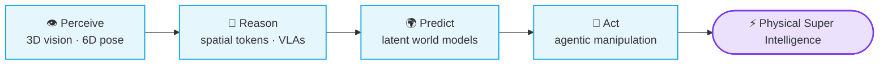

| Stage | Question | Work |
|:--|:--|:--|
| 👁️ **Perceive** | How precisely can a robot recover object pose and geometry? | [C3G-VM6D](https://ieeexplore.ieee.org/document/11400555) · [VLM6D](https://arxiv.org/abs/2511.00120) · [VFM-VLM](https://arxiv.org/abs/2512.07215) · [MSP](https://physical-super-intelligence.github.io/MSP-FRAMEWORK/) |
| 🧭 **Reason** | How should 3D geometry enter a vision-language-action policy? | [GaussVLA](https://gaussvla.github.io/GaussVLA/) · [GST-VLA](https://openreview.net/forum?id=J57nR3hyAd) |
| 🌍 **Predict** | Can an agent imagine the outcome before it acts? | [Agentic-WM](https://physical-super-intelligence.github.io/Agentic-LWM/) · [AGI](https://physical-super-intelligence.github.io/Agentic-Intelligence/) |
| 🦾 **Act** | Can affordances drive zero-shot manipulation, and how do we measure it? | [AFFORD-X](https://physical-super-intelligence.github.io/AFFORD-X/) · [PLUMB-Bench](https://physical-super-intelligence.github.io/PLUMB_Bench/) |

<p align="center">
<code>World Models</code> <code>H/V-JEPA</code> <code>VLAs</code> <code>Agentic Robotics</code> <code>Spatial Intelligence</code> <code>Causal Learning</code> <code>Self Modeling</code> <code>RL Fine-Tuning</code> <code>5D Embodied & Humanoid Intelligence</code>
</p>

## 📚 Selected Publications

<table>
<tr>
<td width="34%" valign="top"><a href="https://gaussvla.github.io/GaussVLA/">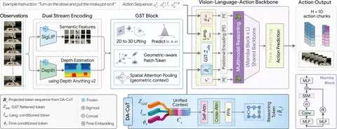</a></td>
<td valign="top">

**GaussVLA: Geometry-Aware Spatial Reasoning for Vision-Language-Action Model**<br>
**Md Selim Sarowar**, Md Tanvir Islam, Sungho Kim\*, Sangtae Ahn<br>
 

[🌐 Project](https://gaussvla.github.io/GaussVLA/) · [📄 OpenReview](https://openreview.net/forum?id=IYv9sR4feE)

<details>
<summary>📋 BibTeX</summary>

```bibtex
@inproceedings{Sarowar_2026_BMVC,
  author    = {Md Selim Sarowar and Md Tanvir Islam and Sungho Kim and Sangtae Ahn},
  title     = {GaussVLA: Geometry-Aware Spatial Reasoning for Vision-Language-Action Model},
  booktitle = {37th British Machine Vision Conference 2026, {BMVC} 2026, Lancaster, UK, November 23-26, 2026},
  publisher = {BMVA},
  year      = {2026},
  url       = {https://bmva-archive.org.uk/bmvc/2026/assets/papers/Paper_121/paper.pdf}
}
```

</details>
</td>
</tr>
<tr>
<td width="34%" valign="top"><a href="https://github.com/s-elim/RWFL-HNH40K">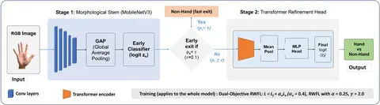</a></td>
<td valign="top">

**HNH40K: A Robust Dataset and Risk-Weighted Learning for Hand Filtering**<br>
Ashikuzzaman†, **Md Selim Sarowar**†, Md Tanvir Islam, Sangtae Ahn, Khan Muhammad<br>
  

[💻 Code](https://github.com/s-elim/RWFL-HNH40K) · [📄 OpenReview](https://openreview.net/forum?id=C23KZbQblz)

<details>
<summary>📋 BibTeX</summary>

```bibtex
@inproceedings{Ashikuzzaman_2026_BMVC,
  author    = {Ashikuzzaman and Md Selim Sarowar and Md Tanvir Islam and Sangtae Ahn and Khan Muhammad},
  title     = {HNH40K: A Robust Dataset and Risk-Weighted Learning for Hand Filtering},
  booktitle = {37th British Machine Vision Conference 2026, {BMVC} 2026, Lancaster, UK, November 23-26, 2026},
  publisher = {BMVA},
  year      = {2026},
  url       = {https://bmva-archive.org.uk/bmvc/2026/assets/papers/Paper_652/paper.pdf}
}
```

</details>
</td>
</tr>
<tr>
<td width="34%" valign="top"><a href="https://ieeexplore.ieee.org/document/11400555">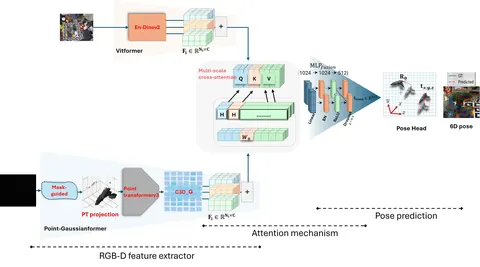</a></td>
<td valign="top">

**C3G-VM6D: Data-Efficient C3G Vision Model Aided 6D Pose Estimation Based on RGB-D Data**<br>
**Md Selim Sarowar**, Manar Alnaasan, Sungho Kim\*<br>
 

[📄 Paper](https://ieeexplore.ieee.org/document/11400555) · [💻 Code](https://github.com/s-elim/C3G-VM6D)

<details>
<summary>📋 BibTeX</summary>

```bibtex
@article{11400555,
  author  = {Sarowar, Md Selim and Alnaasan, Manar and Kim, Sungho},
  journal = {IEEE Access},
  title   = {C3G-VM6D: Data-Efficient C3G Vision Model Aided 6D Pose Estimation Based on RGB-D Data},
  year    = {2026},
  volume  = {14},
  pages   = {34223-34238},
  doi     = {10.1109/ACCESS.2026.3666439}
}
```

</details>
</td>
</tr>
<tr>
<td width="34%" valign="top"><a href="https://www.nature.com/articles/s41598-026-67440-x">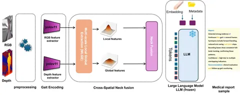</a></td>
<td valign="top">

**Fusion VLM-Gait: RGB-D Fusion in Vision-Language Models for Explainable Multi-Task Parkinsonian Gait Analysis**<br>
Manar Alnaasan, **Md Selim Sarowar**, Sungho Kim\*<br>
 

[📄 Paper](https://www.nature.com/articles/s41598-026-67440-x) · [📥 PDF](https://www.nature.com/articles/s41598-026-67440-x.pdf)

<details>
<summary>📋 BibTeX</summary>

```bibtex
@article{alnaasan2026fusionvlmgait,
  title     = {Fusion VLM-Gait: RGB-D fusion in vision-language models for explainable multi-task Parkinsonian gait analysis},
  author    = {Alnaasan, Manar and Sarowar, Md Selim and Kim, Sungho},
  journal   = {Scientific Reports},
  year      = {2026},
  publisher = {Nature Publishing Group},
  doi       = {10.1038/s41598-026-67440-x},
  url       = {https://www.nature.com/articles/s41598-026-67440-x}
}
```

</details>
</td>
</tr>
<tr>
<td width="34%" valign="top"><a href="https://openreview.net/forum?id=J57nR3hyAd">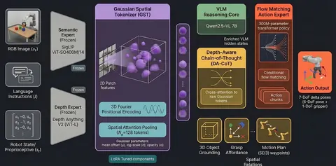</a></td>
<td valign="top">

**GST-VLA: Structured Gaussian Spatial Tokens for 3D Depth-Aware Vision-Language-Action Models**<br>
**Md Selim Sarowar**, Sungho Kim\*<br>


[📄 OpenReview](https://openreview.net/forum?id=J57nR3hyAd) · [📥 PDF](https://openreview.net/pdf?id=J57nR3hyAd)

<details>
<summary>📋 BibTeX</summary>

```bibtex
@inproceedings{sarowar2026gstvla,
  title     = {{GSTVLA}: Structured Gaussian Spatial Tokens for 3D Depth-Aware Vision-Language-Action Models},
  author    = {Md Selim Sarowar and Sungho Kim},
  booktitle = {The 6th Muslims in ML (MusIML) Workshop at ICML 2026},
  year      = {2026},
  url       = {https://openreview.net/forum?id=J57nR3hyAd}
}
```

</details>
</td>
</tr>
</table>

<sub>† Equal contribution &nbsp;·&nbsp; \* Corresponding author</sub>

<details>
<summary><b>📑 More papers, preprints & patents</b></summary>
<br>

**Papers**
- **Dependency-Aware Reliable Orchestration for Smart-IoT Control with Reasoning-Aligned LLMs** — IEEE ICECET 2026 · [Paper](https://ieeexplore.ieee.org/abstract/document/11632566) · [Code](https://github.com/s-elim/Smart-IOT-AI-Agent)
- **VFM-VLM: Vision Foundation Model and Vision Language Model based Visual Comparison for 3D Pose Estimation** — IEIE 2026 · [arXiv](https://arxiv.org/abs/2512.07215)
- **VLM6D: VLM based 6DoF Pose Estimation based on RGB-D Images** — IEIE 2025 · [arXiv](https://arxiv.org/abs/2511.00120)
- **Hand Gesture Recognition Systems: A Review of Methods, Datasets, and Emerging Trends** — IJCA 2025 · [Paper](https://www.ijcaonline.org/archives/volume187/number2/hand-gesture-recognition-systems-a-review-of-methods-datasets-and-emerging-trends/)
- **Improvement of Denoising in Images Using Generic Image Denoising Network (GID Net)** — IEEE AESPC 2021 · [Paper](https://ieeexplore.ieee.org/document/9708513)

**Preprints**
- **Vision-Language-Action and Vision Language Models for Robot Manipulation: A Comprehensive Review Towards Real-World Applications** — under review · [Preprint](https://www.preprints.org/manuscript/202606.0400)
- **What Matters: Datasets or Robust Frameworks in Modern Robot Learning?** — 2026 · [Preprint](https://www.preprints.org/manuscript/202606.1149)

**Granted patents**
- 🇰🇷 **Compact 3D-Gaussian-Based 6D Object Pose Estimation Method for Physical AI** — Korean Patent, 2026
- 🇬🇧 **AI-Enabled Coding and Algorithm Simulation Device** — UK Design Patent, 2025
- 🇮🇳 **IoT-Based System and Design Approach for Health Monitoring of Wearable Devices** — Indian Patent, 2023
- 🇮🇳 **An Experimental Special Technology in Emergency Management and Disaster Response** — Indian Patent, 2022

Full list on the [homepage](https://s-elim.github.io/publications/) and [Google Scholar](https://scholar.google.com/citations?user=zzX9GscAAAAJ&hl=en).

</details>

## 🔬 Ongoing Research

<table>
<tr>
<td width="50%" valign="top">
<a href="https://physical-super-intelligence.github.io/Agentic-Intelligence/">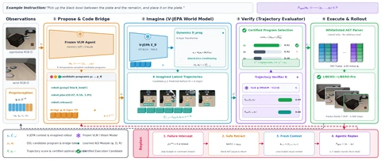</a>

**AGI** — Agentic Intelligence and Latent Lookahead for Robust Manipulation<br>
<sub>Under review · [🌐 Project page](https://physical-super-intelligence.github.io/Agentic-Intelligence/)</sub>
</td>
<td width="50%" valign="top">
<a href="https://physical-super-intelligence.github.io/AFFORD-X/">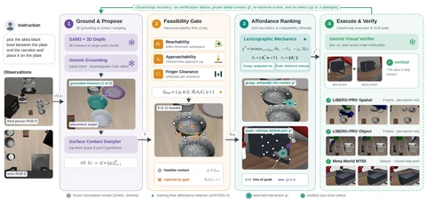</a>

**AFFORD-X** — Affordance-Grounded Agentic Policy for Zero-Shot Robot Manipulation<br>
<sub>Under review · [🌐 Project page](https://physical-super-intelligence.github.io/AFFORD-X/) · [💻 Code](https://github.com/Physical-AGI/AFFORD-X)</sub>
</td>
</tr>
<tr>
<td width="50%" valign="top">
<a href="https://physical-super-intelligence.github.io/Agentic-LWM/">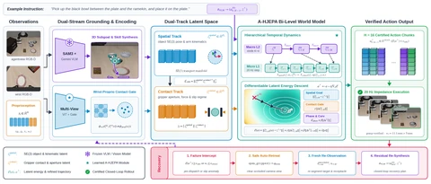</a>

**Agentic-WM** — Grounding Multimodal Policies in Hierarchical Latent World Model<br>
<sub>In preparation · [🌐 Project page](https://physical-super-intelligence.github.io/Agentic-LWM/)</sub>
</td>
<td width="50%" valign="top">
<a href="https://physical-super-intelligence.github.io/MSP-FRAMEWORK/">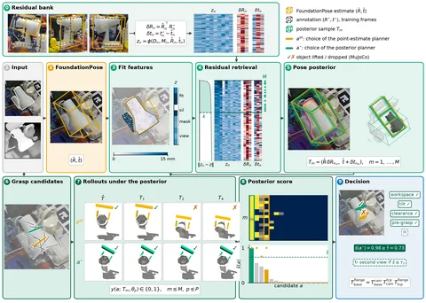</a>

**MSP** — Planning on a Residual-Based Pose Posterior Closes the Grasp-Success Gap Between Estimated and Annotated Object Poses<br>
<sub>Under review · [🌐 Project page](https://physical-super-intelligence.github.io/MSP-FRAMEWORK/) · [💻 Code](https://github.com/s-elim/msp-framework)</sub>
</td>
</tr>
</table>

📦 **PLUMB-Bench** — A Physically Verified Benchmark for Precise, Generalizable Robot Manipulation<br>
<sub>In preparation · [🌐 Project page](https://physical-super-intelligence.github.io/PLUMB_Bench/) · [💻 Code](https://github.com/s-elim/PLUMB_Bench)</sub>

## 🧰 Toolbox

| Area | Stack |
|:--|:--|
| **Deep learning** |      |
| **3D vision** |     |
| **Robotics & simulation** |    |
| **Hardware** |   |
| **Agentic systems** |    |
| **Writing** |  |

## 🎓 Academic Journey


## 🏆 Honors & Awards

- 🏅 **Global Korea Scholarship (GKS)** — NIIED, Republic of Korea · 2024–2027 · full funding for the language program and research M.Sc.
- 🏅 **NTHU International Graduate Students Assistantship** — the highest award for international students at National Tsing Hua University
- 🏅 **Study in India Government Scholarship** — Ministry of Education, India · 2019–2023 · fully funded B.Tech
- 🏅 **KIIT University International Scholarship (KUISP)** — 2019–2023 · academic excellence

<details>
<summary><b>More honors</b></summary>
<br>

- ✈️ **Bangladesh Sweden Trust Fund (BSTF) Travel Grant** — 2024 · research internship in Taiwan
- 🎖️ **Honorary Young Diplomat** — Jeju Province · promoting Korean culture and international engagement
- 🎖️ **National Youth Inspiration Award** — Citizens Open Forum · 2017 · Youth Leadership and Connectivity
- 🏅 **Meritorious Scholarship, Secondary School Certificate** — Bangladesh Ministry of Education · 2016–2018

</details>

## 📈 Activity

<p align="center">
<picture>
  <source media="(prefers-color-scheme: dark)" srcset="https://raw.githubusercontent.com/s-elim/s-elim/output/github-snake-dark.svg">
  <source media="(prefers-color-scheme: light)" srcset="https://raw.githubusercontent.com/s-elim/s-elim/output/github-snake.svg">
  
</picture>
</p>

## 📫 Let's Connect

> [!TIP]
> **Open to research collaborations and PhD opportunities** in world models, vision-language-action models, and agentic robotics.
> Reach me by [email](mailto:selim.sarowar12@gmail.com?subject=Research%20collaboration%20%2F%20PhD%20opportunity), on [LinkedIn](https://www.linkedin.com/in/selimsarowar), or explore more on my [homepage](https://s-elim.github.io/).

<div align="center">
<sub>Advanced Visual Intelligence Lab · Yeungnam University · South Korea</sub>
</div>
